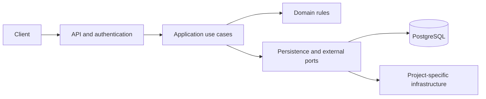

# CourseGraph — Backend Developer Track

**Project 4 of 8 · Java 21 · Spring Boot 3.5.16 · Maven 3.9.9 · PostgreSQL**

> Start with [Getting Started](docs/GETTING_STARTED.md), then [Submission Rules](docs/SUBMISSION_RULES.md). The complete rules are below; milestone checklists point back here.

## 1. Overview

Build **CourseGraph**, a backend for **tenant-isolated learning platform with graphql**. You implement the application, data model, API and failure handling. The learning focus is: Spring for GraphQL, schema design, DataLoader, N+1 queries, cursor pagination, PostgreSQL tenant isolation/RLS, Redis cache scoping, query budgets, Spring Batch.

This is original learning material organized like the supplied `substream.zip`: numbered specification, stable business-rule IDs, M1–M3 shared milestones, D4–D7 developer milestones, an AQA guide and reflection. It is not connected to the SubStream/NIX grading bot. The reference project is [SubStream](https://github.com/Abd-Elrahman3/SubStream-Developer-Track); no completed solutions or proprietary bot are included.

## 2. How the Challenge Works

### 2.1 Milestones

Do projects in order. Prerequisite: complete D7 of [ParcelRelay](https://github.com/Abd-Elrahman3/03-parcelrelay-spring-boot) and explain its failure drills.
Every milestone is required. Advanced requirements are part of completion, not optional stretch goals. M1–M3 establish the model, database and transactions; D4–D7 add contracts, difficult behavior, failure recovery and operation.

| Milestone | Goal | Branch | Guide |
| --- | --- | --- | --- |
| M1 | Domain and invariants | `feature/m1-domain` | [Shared](docs/SHARED_MILESTONES.md) |
| M2 | Database and persistence | `feature/m2-database` | [Shared](docs/SHARED_MILESTONES.md) |
| M3 | Transactional use cases | `feature/m3-transactions` | [Shared](docs/SHARED_MILESTONES.md) |
| D4 | API contracts and authorization | `feature/d4-api` | [Developer](docs/TRACK_DEVELOPER.md) |
| D5 | Advanced behavior and resource limits | `feature/d5-advanced` | [Developer](docs/TRACK_DEVELOPER.md) |
| D6 | Failure testing and recovery | `feature/d6-failures` | [Developer](docs/TRACK_DEVELOPER.md) |
| D7 | Operations and design defense | `feature/d7-operations` | [Developer](docs/TRACK_DEVELOPER.md) |

### 2.2 Levels

Bronze = M2; Silver = D4; Gold = D6; Platinum = D7 **with evidence**. Complete Platinum before progressing to the next project. A blocked feature should get a smaller reproducible experiment; do not mark it complete by removing its assertion.

### 2.3 How your work is evaluated

The starter compiles and runs only packaging tests by default. Behavioral examples and test exercises intentionally fail. `python3 scripts/check_progress.py --through M1` runs the cumulative milestone tests and checks evidence; advance through D7. The workflow runs this gate on milestone PR branches. A green starter build proves packaging only.

Automation is a guardrail, not proof of understanding. You own these repositories and can bypass local checks; keep the gates intact, review tests and explain tradeoffs aloud. There is no hidden evaluator and branch protection is not configured by these files.

## 3. Architecture



The API binds and validates transport input. The service establishes authorization and transaction boundaries. Domain objects enforce state rules. Persistence adapters map database data without leaking entities to API responses. Dependencies and clocks are constructor-injected. Keep network calls outside long database transactions and record uncertain outcomes explicitly.

See [Database Requirements](docs/DATABASE_REQUIREMENTS.md), [API Requirements](docs/API_REQUIREMENTS.md) and [Architecture Decisions](docs/ARCHITECTURE_DECISIONS.md) for this project's concrete boundaries.

### 3.1 How the classes relate

| Area | Responsibility |
| --- | --- |
| domain | Course, Lesson, Enrollment, Progress |
| service | Use cases, transaction boundary and principal-derived identity |
| repository / persistence | Ports, SQL/JPA/R2DBC mappings, constraints and query strategy |
| api | DTOs, controllers/resolvers, validation and error mapping |
| advanced | Required project-specific workers, policies and adapters |
| config | Dependency injection, Clock, security, typed configuration |

## 4. Domain Model

| Type | Fields / types | Invariant |
| --- | --- | --- |
| Course | UUID id; UUID tenantId; String title; CourseStatus status; long version | DRAFT → PUBLISHED → ARCHIVED. Publishing requires at least one lesson. |
| Lesson | UUID id; UUID tenantId; UUID courseId; String title; int position | Position >=1 and unique per tenant/course. |
| Enrollment | UUID id; UUID tenantId; UUID courseId; String learnerSubject; Instant enrolledAt | Unique(tenantId,courseId,learnerSubject); only published courses enroll. |
| Progress | UUID tenantId; UUID enrollmentId; UUID lessonId; Instant completedAt | Unique(tenantId,enrollmentId,lessonId); completion is idempotent. |

Fields are private. Do not add public state setters to bypass business methods. A rejected domain operation changes nothing. IDs are UUIDs unless explicitly stated otherwise. Identity equality uses persistent ID; value objects use their values. Store timestamps as UTC `Instant`; use `LocalDate` only for calendar-date rules. Nullability is explicit in database/API specs; unknown IDs are never treated as empty success. Use `ConflictException` for invalid state transitions and `IllegalArgumentException` for invalid domain values. Constructor signatures in starter examples are stable; you may add overloads, private fields and new classes as requirements grow.

The declared fields and constructors are scaffolding; constructors and business methods throw `UnsupportedOperationException("TODO: ...")`. Getters, enum values, Clock and the application entry point are provided. See [Starter Map](docs/STARTER_MAP.md).

## 5. Business Rules

Rule IDs are local to this repository. Each rule includes a concrete acceptance example. Full behavior, boundaries and failures matter; the examples are a starting test set.

### M1 — Domain and invariants

#### BR-101 — Model publication rules

Trim title to 1..200 characters. DRAFT publishes only with >=1 lesson. ARCHIVED is terminal; no new enrollment in DRAFT or ARCHIVED. Existing enrolled learners retain read access to archived material.

**Acceptance example:** Publishing an empty course fails unchanged; archiving prevents new enrollment but preserves existing progress.

#### BR-102 — Calculate progress precisely

A completion belongs to an enrollment and a lesson of the same course and tenant. Repeated completion preserves first completedAt. Percentage is completed required lessons / required lessons *100, scale 2 HALF_UP; zero lessons yields 0.00.

**Acceptance example:** 1 of 3 → 33.33; 2 of 3 → 66.67; duplicate completion does not make 4 of 3.


### M2 — Database and persistence

#### BR-201 — Enforce tenant-safe relationships

All business tables carry tenant_id. Use UNIQUE(tenant_id,id) and composite foreign keys including tenant_id. A valid course ID from another tenant must fail a lesson/enrollment insert. Do not rely solely on a controller filter.

**Acceptance example:** Raw SQL attempting tenant A enrollment into tenant B course fails a constraint.

#### BR-202 — Layer row-level isolation

Enable PostgreSQL RLS with current_setting for tenant context; app role cannot bypass RLS or own tables. Set tenant context transaction-locally using parameterized set_config(...,true), never a persistent pooled-connection SET. Tenant comes from a verified JWT membership claim.

**Acceptance example:** Reuse one pooled connection for alternating tenants; no rows or settings leak. A missing tenant context denies access.


### M3 — Transactional use cases

#### BR-301 — Implement cursor pagination

Courses ordered by createdAt DESC,id DESC. Opaque cursor contains ordering tuple and filter fingerprint, authenticated with HMAC; validate tenant/filter context. first defaults 20, range 1..100; return edges,pageInfo. Do not use offset as the cursor.

**Acceptance example:** Insert a newer course between page 1 and page 2; previously seen courses are not duplicated. Changed filter/tenant cursor → BAD_USER_INPUT.

#### BR-302 — Batch nested loads

Use request-scoped DataLoader/@BatchMapping for lessons, enrollment counts and progress. Batch keys include tenant. Resolve a page of 20 courses and nested lessons in <=4 SQL queries for the specified operation. Disable lazy loading outside transactions.

**Acceptance example:** The same operation for 1 vs 20 courses does not grow query count linearly; concurrent tenant requests do not share cache entries.


### D4 — API contracts and authorization

#### BR-401 — Implement the GraphQL schema

Implement api/schema.graphqls using typed @QueryMapping/@MutationMapping/@SchemaMapping. Mutations accept clientMutationId for correlation only; completeLesson and enroll use database uniqueness for idempotency. HTTP 200 may include GraphQL errors; clients must inspect errors and data.

**Acceptance example:** GraphQlTester verifies nullability, aliases, variables and partial data without exposing stack traces.

#### BR-402 — Authorize fields and mutations

JWT issuer/audience coursegraph-api, sub and tenant membership are required. Instructors manage their tenant courses; learners mutate only their enrollments. Check service boundaries and nested fields, not just /graphql URL.

**Acceptance example:** An alias and a nested resolver cannot fetch another tenant’s enrollment or another learner’s private progress.


### D5 — Advanced behavior and resource limits

#### BR-501 — Bound query cost

Limit depth to 8, computed complexity to 200 and document size to 32KiB. Charge list field cost by requested first and nested selection cost; limit aliases. Reject excess work before DB execution with QUERY_TOO_COMPLEX.

**Acceptance example:** A shallow query with 500 aliases is rejected; repeated fragments cannot evade the budget.

#### BR-502 — Cache with tenant-aware invalidation

Cache public course summaries in Redis for 30s using tenant+course+schema-version keys. Evict only after commit. Never share per-user progress cache across users. A cache outage falls back to PostgreSQL with bounded concurrency.

**Acceptance example:** Tenant A and B with matching logical keys see only their data; rolled-back updates do not poison caches.


### D6 — Failure testing and recovery

#### BR-601 — Restart bulk imports

Use Spring Batch to import CSV course lessons in chunks of 100. A durable import job stores file checksum and tenant; unique (job_id,row_number) prevents duplicate effects. Invalid rows go to an error report; reject duplicate lesson positions deterministically.

**Acceptance example:** Stop after chunk 2 of 1,000 rows, restart the same job parameters and produce exactly the valid rows once.

#### BR-602 — Test security and query shape

Use GraphQlTester, PostgreSQL Testcontainers with the non-owner app role, SQL-count assertions and Redis tests. Cover transaction-local tenant settings and batch-loader request isolation.

**Acceptance example:** Removing tenant from either a composite FK or a DataLoader key makes a required test fail.


### D7 — Operations and design defense

#### BR-701 — Observe GraphQL safely

Measure latency/error counts by approved operation name, query rejection, DataLoader batch sizes and SQL count. Never label metrics with raw documents or learner IDs. Log a normalized operation hash and trace ID.

**Acceptance example:** Identify a slow nested resolver in a trace and show an index/query change reducing its time under the same dataset.

#### BR-702 — Evolve the schema without breaking clients

Add a field, deprecate an old one with a reason, keep it for the exercise, and run an old recorded client operation. Propose a removal policy based on observed usage. Export/delete one tenant in bounded jobs without touching others.

**Acceptance example:** Restore tenant A export to an isolated database and prove counts; delete A and prove B’s counts and progress are unchanged.

## 6. Provided Infrastructure

Provided: pinned Maven build/wrapper, application entry point, UTC Clock bean, domain/API/repository/advanced stubs, Docker Compose, environment example, migration placeholder, API contract examples, packaging tests, intentionally red learning tests, CI and a cumulative gate. PostgreSQL migrations, business logic, authentication policy, transport handlers and behavior tests remain your work. Initial startup is not claimed until the required schema/configuration is implemented.

External providers must be mocked locally. No real payments, messages to customers or paid cloud accounts are needed. Install only the components required for the current milestone. See setup instructions for versions and ports.

## 7. Project Structure

```text
README.md                     full model and business rules
REFLECTION.md                 evidence of understanding
docs/GETTING_STARTED.md        setup and first milestone
docs/SHARED_MILESTONES.md       M1–M3 checklists
docs/TRACK_DEVELOPER.md         D4–D7 checklists
docs/TRACK_AQA.md               mandatory complementary testing track
docs/SUBMISSION_RULES.md        branches, commits, completion rules
docs/DATABASE_REQUIREMENTS.md  schema, constraints, indexes, migrations
docs/API_REQUIREMENTS.md       transport, status, auth and payload rules
docs/ACCEPTANCE_TESTS.md        failure and boundary test matrix
docs/ADVANCED_BACKEND_GATES.md  non-optional completion evidence
docs/LEARNING_PATH.md           eight-project progression
docs/primers/                  short concept guides and official references
docs/aqa/                      API test guidance
docs/evidence/                 fill after reproducing each milestone
pom.xml, mvnw, .mvn/            pinned build and wrapper
src/main/java/                unfinished application
src/test/java/                packaging checks and learning tests
src/main/resources/           application config and migration placeholder
api/                          contract and request examples
compose.yaml, .env.example     local infrastructure
scripts/check_progress.py     cumulative learning gate
.github/workflows/            starter build and milestone gate
```

## 8. What Good Code Looks Like Here

Use clear transaction boundaries, immutable DTOs, constructor injection and small use cases. Never depend on H2 to prove PostgreSQL locking/constraints. Never log credentials. Tests assert durable state and externally observable behavior, not only mocked call counts. Keep request/broker buffers bounded and retries limited. Explain every index, retry and trust boundary you introduce. Record actual measurements instead of assuming a technology is faster.

This curriculum covers a broad backend progression; it does not claim to exhaust every Spring module. [Learning Path](docs/LEARNING_PATH.md) maps the concepts and identifies follow-on subjects.

See [Implementation Labs and Contract Details](docs/IMPLEMENTATION_LABS.md) for concrete fixtures, payload semantics and boundary experiments. These are required, not optional extras.
